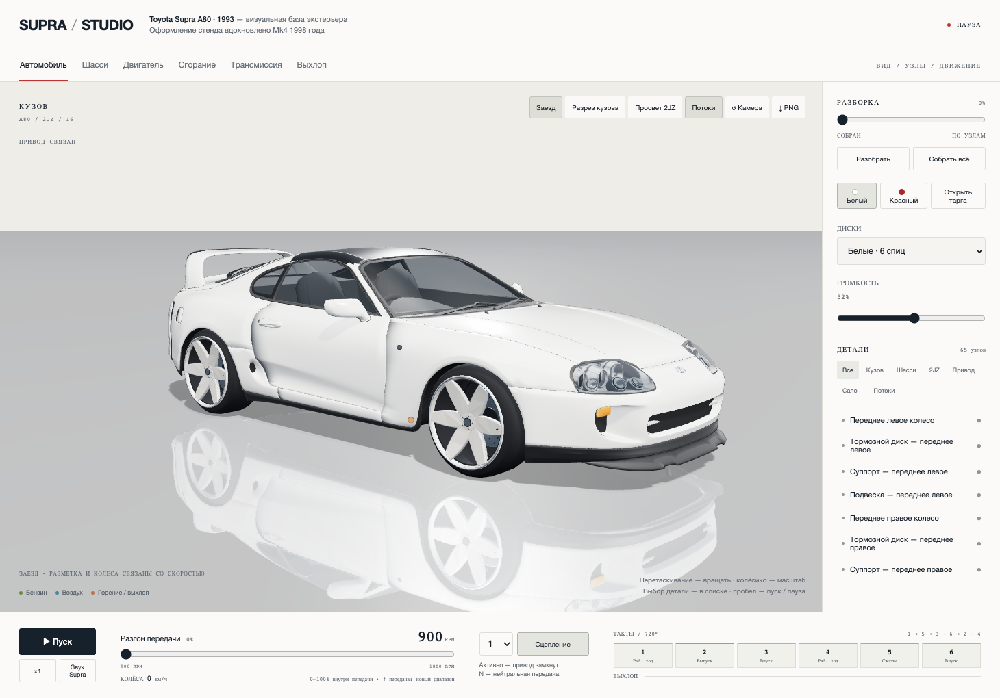

# Supra Studio — Sound & Drive Edition

Интерактивный 3D-стенд Toyota Supra A80: автомобиль можно осматривать, разбирать по узлам и запускать демонстрацию работы двигателя, трансмиссии, сгорания и выхлопа.

Проект работает **офлайн в браузере**. Готовый `index.html` содержит код, модель и аудио; для запуска не нужны сервер, Node.js, Blender или интернет.



> Внешняя база — **Toyota Supra A80 1993** автора Lexyc16. Оформление вдохновлено Mk4 1998 года, но проект не является точной CAD-копией автомобиля 1998 года, официальным продуктом Toyota или физически достоверным автосимулятором.

## Возможности

| Раздел | Что можно сделать |
| --- | --- |
| Автомобиль | Вращать камеру, приближать модель, менять белый/красный цвет кузова, открывать тарга-панель |
| Разборка | Разнести сборку ползунком, выбрать и снять узел, собрать автомобиль обратно; доступны 65 групп деталей |
| Двигатель | Изучить прежнюю процедурную модель рядного шестицилиндрового 2JZ: поршни, коленвал, распредвалы и рабочие циклы |
| Сгорание и выхлоп | Увидеть условное воспламенение, движение газов и изменение интенсивности выхлопа |
| Трансмиссия | Переключать N / 1–6, размыкать сцепление; снятие кардана отключает привод колёс |
| Заезд | Движущаяся дорога и разметка, вращение четырёх колёс, визуальное размытие спиц на скорости |
| Диски | Белые 6-спицевые, белая звезда 5 спиц, хром с глубокой полкой, бронза 10 спиц и заводской вариант |
| Звук | Обработанная запись мотора Supra, зависимость звучания от оборотов и нагрузки, смонтированный turbo-flutter при переключении и сбросе |
| Управление | Пуск/пауза, регулировка громкости, замедление механики ×1/35, прозрачность кузова/двигателя и экспорт PNG |

## Быстрый запуск

1. Скачайте или клонируйте репозиторий. Если скачали ZIP — полностью распакуйте его.
2. Откройте **`index.html`** в современном браузере с WebGL и Web Audio.
3. Нажмите **«Пуск»**. Для аудио отдельно нажмите **«Звук Supra»**.
4. В режиме **«Автомобиль»** оставьте включённым **«Заезд»** и двигайте ползунок разгона.

Звук не включается автоматически. Громкость регулируется в правом инспекторе. На слабом компьютере уменьшите окно и закройте тяжёлые вкладки. Совместимость с абсолютно любым оборудованием не гарантируется.

### Основные действия

- Перетаскивание мышью — вращение камеры; колесо мыши — масштаб.
- Пробел или кнопка **«Пуск / Pause»** — запуск и остановка.
- Кнопки сверху — автомобиль, шасси, двигатель, сгорание, трансмиссия и выхлоп.
- **«Разобрать»**, ползунок разборки и **«Собрать всё»** — разнесение и сборка.
- Выберите узел в списке или на модели и нажмите **«Снять деталь»**.
- **«PNG»** — сохранить изображение сцены.

Подробная инструкция: [docs/INSTRUCTIONS.ru.txt](docs/INSTRUCTIONS.ru.txt).

## Как работает ползунок передач

В заезде используется заказанная **учебная схема накопительных диапазонов**, а не настоящая педаль газа:

1. На первой передаче ползунок 0–100% соответствует диапазону **900–1800 RPM**.
2. При повышении передачи ползунок возвращается к **0%**, но достигнутые обороты и скорость сохраняются.
3. Следующий диапазон начинается с этих значений. При переключении на пределе это примерно **1800–2700 RPM**, затем **2700–3600 RPM** и далее.
4. При раннем повышении диапазон начинается с реально набранного значения, без мгновенного скачка показателей.
5. Текущие границы подписаны под ползунком. При снижении передачи положение пересчитывается, а изменение показателей сглаживается.

В режиме стенда и внутренних видах сохранён обычный учебный газ **900–6900 RPM**. N, разомкнутое сцепление и снятый кардан разрывают привод; дорожный выбег не моделируется.

## Звук и его происхождение

**Мотор:** используется реальная запись, которую автор **editboy23** описывает как Toyota Supra на диностенде. Фрагменты зациклены с обработкой стыков, смешиваются и меняют скорость воспроизведения под обороты. Год, вариант двигателя и тюнинг записанной машины отдельно не подтверждены.

**«Stutututu»:** эффект смонтирован из короткого фрагмента записи **Turbo Spooling and Blow Off** автора **EwanPenman11**. Применены фильтрация, нормализация и последовательность затухающих импульсов. Это **не подтверждённая запись естественного flutter именно этой Supra**.

Оба аудиоисточника опубликованы по CC0. Ссылки, авторы и описание обработки находятся в [ATTRIBUTION.txt](ATTRIBUTION.txt).

## Структура проекта

```text
index.html                 Готовое самодостаточное приложение
src/
  template.html            Интерфейс и стили
  app.js                   Управление, анимация, заезд, диски, аудио и диапазоны передач
  engine.js                Процедурная модель двигателя
  chassis.js               Шасси и трансмиссия
  body.js                  Подключение и адаптация кузова
assets/
  supra.glb                Модель с очищенными служебными метаданными
  engine.mp3               Запись двигателя
  turbo-grain.mp3           Подготовленный короткий фрагмент для эффекта
vendor/
  three.bundle.min.js      Встроенный Three.js r160, GLTFLoader и Reflector
tools/build.py             Офлайн-сборка средствами стандартной библиотеки Python
tests/                     Проверки сборки и браузерные тесты
docs/                      Иллюстрация и инструкция
licenses/                  Тексты лицензий компонентов
ATTRIBUTION.txt            Источники и изменения
LICENSE.md                 Пояснение условий использования компонентов
```

## Разработка и сборка

Для просмотра достаточно `index.html`. Для изменения проекта редактируйте файлы в `src/`, затем пересоберите HTML:

```bash
python3 tools/build.py
```

На Windows при необходимости используйте:

```powershell
py -3 tools/build.py
```

Сборщик не скачивает зависимости и не использует настройки компьютера автора. Он встраивает локальные ресурсы в HTML и повторно удаляет из GLB служебные `extras` экспортёра, сохраняя атрибуцию и бинарную геометрию. Готовый `index.html` включён в репозиторий и намеренно не исключён через `.gitignore`.

### Тестирование

Проверки сборки используют стандартную библиотеку Python:

```bash
python3 -m unittest discover -s tests -p test_build.py
```

Для браузерных тестов нужны Node.js/npm и Chromium для Playwright. Установка тестовых инструментов требует сети; само приложение и тестируемые страницы работают офлайн.

```bash
npm ci
npx playwright install chromium
npm test
```

Тесты проверяют диапазоны передач, непрерывность показателей, звук и отмену импульсов на паузе, все варианты дисков, движение дороги и колёс, разборку, кинематику двигателя, PNG-экспорт и мобильную вёрстку. Артефакты тестов сохраняются в `tests/.artifacts/` и не входят в репозиторий.

## Подготовка к публикации

- Публикуйте файлы **этого проекта**, не личные рабочие каталоги и не настройки ассистента.
- `.gitignore` исключает зависимости, кэши, локальные настройки и типичные файлы с секретами.
- Из встроенной модели удалены метаданные плагинов и исходные локальные пути; сведения об авторе и лицензии сохранены.
- В проверенной сборке не обнаружены пользовательские ключи, токены или личные пути. Проверенный запуск и управление не создавали внешних HTTP-запросов. Это не гарантия отсутствия любой возможной уязвимости.
- При добавлении своих ресурсов и интеграций проверяйте их отдельно. `.gitignore` не заменяет проверку содержимого и уже опубликованной истории.

## Лицензии и ограничения

У компонентов **разные лицензии**; весь репозиторий нельзя объявлять исключительно MIT или CC0.

| Компонент | Источник | Условия |
| --- | --- | --- |
| Авторская внешняя геометрия и её адаптация | Lexyc16, Toyota Supra (A80) 1993 | CC BY-NC 4.0 — атрибуция и некоммерческое использование |
| Three.js и включённые модули | Авторы Three.js | MIT |
| Записи двигателя и турбины | editboy23, EwanPenman11 | CC0 1.0 |

Сохраняйте [ATTRIBUTION.txt](ATTRIBUTION.txt), [LICENSE.md](LICENSE.md) и папку [licenses](licenses/). Публичная публикация не отменяет ограничений исходных компонентов. Для коммерческого использования сторонней геометрии потребуется отдельно разобраться с правами и разрешениями.

Модель не является заводской CAD-копией; разборка выполняется по представленным группам, не до каждого винта. Сгорание, выхлоп и трансмиссия показаны условно; точная динамика автомобиля, аэродинамика, сцепление шин и акустика двигателя не рассчитываются.
